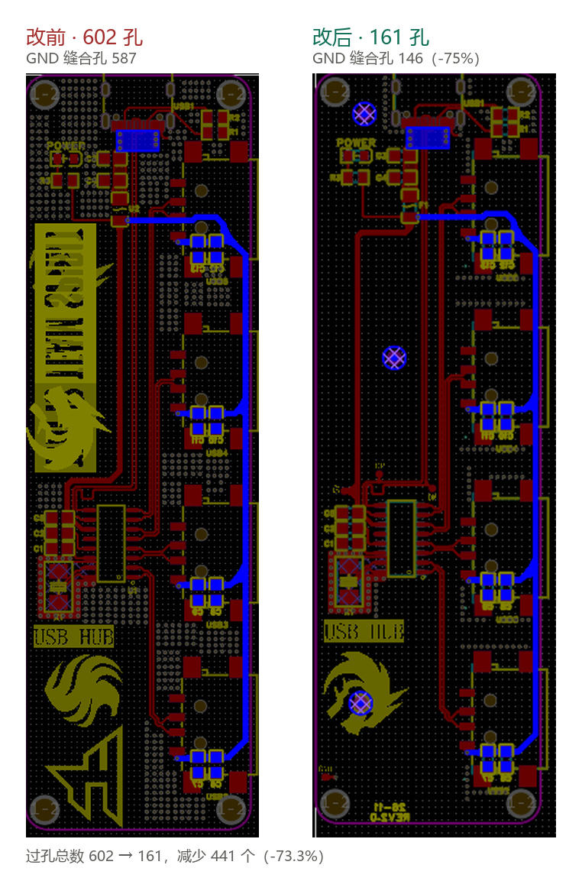

# USB 拓展坞

个人 PCB 项目：一块 USB 集线器方案的拓展坞板子。已经过一轮试制改版。

## 基本信息

| 项目 | 内容 |
|---|---|
| 设计工具 | 立创EDA 专业版 3.2.149 |
| 当前版本 | Rev2.0（板面丝印 `REV2.0`） |
| 初版日期 | 2025-12-14 |
| 最后修改 | 2026-11-05 |
| 状态 | Rev2.0 待打样 |
| V1.0 工程 | `Project_V1.0/ProPrj_USB拓展坞_2026-11-04.epro2` |
| Rev2.0 工程 | `Project_V2.0/ProPrj_USB拓展坞_2026-11-05.epro2` |

## 目录结构

```
docking-station/
├── README.md
├── CHANGELOG.md
├── .gitignore
├── Project_V1.0/
│   └── ProPrj_USB拓展坞_2026-11-04.epro2     初版
├── Project_V2.0/
│   └── ProPrj_USB拓展坞_2026-11-05.epro2     问题修版
└── docs/
    ├── V1-问题复盘.md
    └── images/
```

`.epro2` 是立创EDA专业版的完整工程包（原理图和 PCB 都在这一个文件里），
用客户端的「打开工程」直接打开，不要解压后手动改里面的内容。

## 改版记录

V1.0 试制后发现 4 个问题，Rev2.0 已修：

| # | 问题 | 改动 | 结果 |
|---|---|---|---|
| 1 | 缝合孔过量 | GND 缝合孔 587 → 146 | 过孔总数 -73.3%，钻孔成本明显下降 |
| 2 | 整板无测试点 | 加 `+5V` / `GND` / `DP` / `DM` | 可在板上直接探针测量 |
| 3 | 无版本标识 | 丝印加 `2026-11` + `REV2.0` | 肉眼可区分版本，避免混版错料 |
| 4 | 无 Mark 点 | 加 3 个光学基准点 | 贴片机可光学对位 |



逐条的详细分析（含数据、成本估算、遗留问题）：[docs/V1-问题复盘.md](docs/V1-问题复盘.md)

完整版本记录：[CHANGELOG.md](CHANGELOG.md)

## 方案要点

- 主控 / Hub 芯片：待填
- 供电方案：待填（USB 取电 / 外部 DC）
- 接口配置：待填（例如 USB-A 1 进 4 出、USB 2.0 还是 3.0）
- 板层：待填（2 层 / 4 层）
- 板厚 / 外形尺寸：待填
- 主要元件：晶振 SMD5032、贴片阻容 SMD1206 等

## 备注

- 导出产物（Gerber、BOM、坐标文件）是否入库，见 `.gitignore` 里的注释说明。
- 改版时新建 `Project_Vn.0/` 目录，旧版本保留不删，方便对比。
