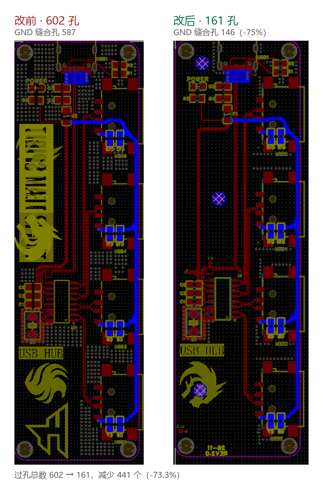

# USB 拓展坞

个人 PCB 项目：一块 USB 集线器方案的拓展坞板子。已经过一轮试制改版。

## 基本信息

| 项目 | 内容 |
|---|---|
| 设计工具 | 立创EDA 专业版 3.2.149 |
| 当前版本 | Rev2.0（板面丝印 `REV2.0`） |
| 初版日期 | 2025-12-14 |
| 最后修改 | 2026-11-19 |
| 状态 | Rev2.0 已试制 5 片，手焊调试中 |
| V1.0 工程 | `Project_V1.0/USB拓展坞_V1.0.epro2` |
| Rev2.0 工程 | `Project_V2.0/USB拓展坞_V2.0.epro2` |

## 目录结构

```
docking-station/
├── README.md
├── CHANGELOG.md
├── .gitignore
├── Project_V1.0/
│   └── USB拓展坞_V1.0.epro2              初版
├── Project_V2.0/
│   ├── USB拓展坞_V2.0.epro2              问题修版（当前）
│   ├── USB拓展坞_V2.0_Gerber.zip         打样文件
│   ├── USB拓展坞_V2.0_BOM.xlsx           物料清单
│   └── PCB_PCB1_2026-11-19.pdf           PCB 图（导出）
└── docs/
    ├── V1-问题复盘.md
    ├── V2-焊接调试记录.md
    ├── 拓展坞排查清单.md
    └── images/
```

一个版本一个目录：工程本体和该版导出的 Gerber / BOM 放一起，不散在根目录。
文件命名统一「名称 + 版本」，不带日期。

`.epro2` 是立创EDA专业版的完整工程包（原理图和 PCB 都在这一个文件里），
用客户端的「打开工程」直接打开，不要解压后手动改里面的内容。

## 改版记录

V1.0 试制后发现 4 个问题，Rev2.0 已修：

| # | 问题 | 改动 | 结果 |
|---|---|---|---|
| 1 | 缝合孔过量 | GND 缝合孔 587 → 146 | 过孔总数 -73.3%，钻孔成本明显下降 |
| 2 | 整板无测试点 | 加 `+5V` / `GND` / `DP` / `DM` | 可在板上直接探针测量 |
| 3 | 无版本标识 | 丝印加 `2026-11` + `REV2.0` | 肉眼可区分版本，避免混版错料 |
| 4 | 无 Mark 点 | 加 3 个光学基准点 | 贴片机可光学对位 |



逐条的详细分析（含数据、成本估算、遗留问题）：[docs/V1-问题复盘.md](docs/V1-问题复盘.md)

## 试制情况（2026-11-19）

打样 5 片，手焊 2 片，均未跑通，故障全部出在焊接工艺，**设计无错**。

| 板 | 结果 | 原因 |
|---|---|---|
| 第 1 片 | 报废 | Type-C 座在 D+/D- 短路状态下通电，助焊剂碳化成导电物，+5V 对地 2Ω |
| 第 2 片 | 未完成 | 曾短暂枚举（提示「无法识别」），补焊后无反应，待查 U1 与晶振 |

排查流程、实测电压/通断数据、焊接教训：[docs/V2-焊接调试记录.md](docs/V2-焊接调试记录.md)

测试点位置与 PCB 标注图：[docs/拓展坞排查清单.md](docs/拓展坞排查清单.md)

完整版本记录：[CHANGELOG.md](CHANGELOG.md)

## 方案要点

- 主控 / Hub 芯片：SL2.1A（SOP-16，USB2.0 四口 HUB，内置 5V→3.3V/1.8V LDO）
- 供电方案：Type-C 取电，VBUS 经 F1（1.5A 自恢复保险丝）后供全板
- 接口配置：Type-C 上行 1 进，USB-A 下行 4 出，USB 2.0
- 上行识别：CC1/CC2 各 5.1k 下拉（C-to-C 线必需）
- 时钟：12MHz 晶振直连 XIN/XOUT（芯片内置匹配电容）
- 板层：2 层
- 板厚 / 外形尺寸：1.6mm / 约 31 × 100 mm
- 主要元件：SL2.1A、Type-C 16P 母座、USB-A 母座 ×4、SMD5032 晶振、0805 阻容

## 备注

- 导出产物（Gerber、BOM、坐标文件）是否入库，见 `.gitignore` 里的注释说明。
- 改版时新建 `Project_Vn.0/` 目录，旧版本保留不删，方便对比。
- 每版导出的 Gerber / BOM 放进对应 `Project_Vn.0/`，文件名带同一版本号，避免混版错料。
