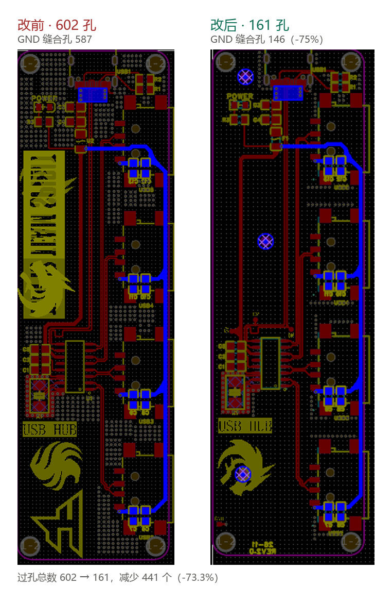
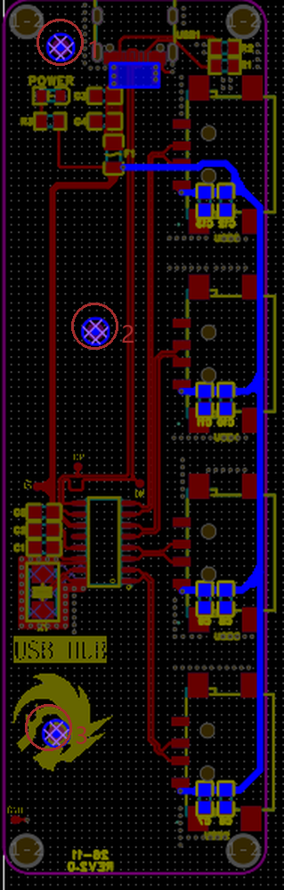

# V1 问题复盘

第一版打样前/试制后发现的问题，以及 Rev2.0 的改动记录。

改前改后的过孔分布对比：

> 过孔总数 602 → 161，减少 441 个（-73.3%）。

---

## 问题 1：587 个缝合孔过度

**现象**：全板 GND 缝合孔 587 个，孔径 0.3mm，过孔总数 602 个。

**改动**：去掉大部分缝合孔，只保留并重新规划一小部分。

**原因**：

- 孔太密，阻焊层盖不住，过孔开窗露铜；
- 塞孔工艺下残药水排不干净，后续工序污染；
- 钻孔按孔数计价，孔数翻倍等于成本翻倍。

**效果** `[实测]`：

| 项目 | V1.0 | Rev2.0 | 变化 |
|---|---|---|---|
| 过孔总数 | 602 | 161 | **-441（-73.3%）** |
| GND 缝合孔 | 587 | 146 | **-441（-75.1%）** |
| 电源/信号过孔 | 11 | 11 | 不变 |
| 安装孔（3.0mm） | 4 | 4 | 不变 |

缝合孔减少的 441 个，全部来自 GND 网络，走线和电源过孔一个没动，说明功能连接没受影响。

按板厂孔数计价（0.3mm 机械钻孔批量约 ¥0.01~0.02/孔）估算：
单片省 ¥4.4~8.8，100 片省 ¥440~880。打样阶段不显眼，量产放大后差距明显。

**遗留**：去掉缝合孔后，需确认大铜皮的回流路径没有断点，尤其 GND 分割处。Rev2.0 保留的 146 个应集中在关键回流路径和板边。

---

## 问题 2：整板没有一个测试点

**现象**：板上所有网络都没有可探针接触的测试焊盘，维修和检测只能靠飞线或拆焊。

**改动**：增加 4 个测试点：`+5V`、`GND`、`DP`、`DM`。

**原因**：出问题无法快速定位是供电、地还是差分信号，维修成本高。

**效果** `[预期]`：常用电源轨和差分对可 3 秒内直接测量，不用拆壳飞线。

**风险提示（必须确认）**：DP/DM 是 USB 差分对，测试点等于在走线上挂了一个分支（stub），会造成阻抗不连续和反射。正确做法是：

- 焊盘做小（约 1.0mm），**不要**用大圆盘直接挂在主走线中段；
- 用尽量短的引线（< 5mm）从走线侧面引出；
- DP、DM 两个测试点对称布置，间距与走线一致。

如果这四个测试点是大焊盘直接压在 DP/DM 主线上，需要回去改成侧引。

---

## 问题 3：板上没有版本标识和日期

**现象**：板面无任何版本号、日期，多版板子混在一起肉眼无法区分，贴错 BOM 就是整批报废。

**改动**：丝印增加日期与版本号，当前内容为 `2026-11` / `REV2.0`。

**原因**：混版无法识别 → 错料 → 整批报废。

**效果** `[实测]`：丝印已存在，肉眼可直接区分版本。

**版本号三处已统一**（原先是板面、目录、文档对不上，正是"混版"风险的来源）：

| 位置 | 当前写法 |
|---|---|
| 板面丝印 | `2026-11` + `REV2.0` |
| 工程目录 | `Project_V2.0/` |
| README | Rev2.0 |

板子、文件夹、文档现在指向同一个版本，不会有人误判后贴错 BOM。

日期格式已确认保持 `2026-11`（精确到月，不加日）。**同月内如果出第二版，必须靠版本号区分**（`REV2.0` → `REV2.1`），不要两个不同批次都叫 REV2.0。

---

## 问题 4：没有 Mark 点

**现象**：板上无光学基准点，贴片机只能靠板边外形估位置。

**改动**：增加 3 个 Mark 点。

**原因**：SOP-16 引脚间距 1.27mm，板边定位误差超过 0.3mm 就会偏出焊盘。

**效果** `[预期]`：贴装精度由板边定位的 ±0.3~0.5mm 提升到光学对位的 ±0.05~0.1mm（数据为贴片机规格，非本板实测，打样后需实测确认）。

**⚠️ 布置问题：三个点全在板子左侧。**

实测三点位置（截图像素坐标，板宽约 175px）：

| 编号 | 位置 | 备注 |
|---|---|---|
| 1 | 左上，接近板角 | |
| 2 | 中左 | |
| 3 | 左下（logo 上） | |

三点横向跨度只有约 31px，占板宽的 18%，左侧挤成一列，**右侧 USB 连接器和走线密集区没有任何基准**。细长板尤其吃亏——离基准点越远，对位误差越大。

三个点不共线（能解出旋转），但几何强度接近退化，实际对位精度会打折扣。

**建议**：把 3 号点移到**右下角**，形成左上 / 中左 / 右下的三角覆盖。另外 Mark 点规范供核对：

- 直径 1.0mm 裸铜，周围 2mm 无阻焊开窗；
- 与板边距离 ≥ 5mm；
- 表面处理优先沉金（喷锡表面不平，影响识别）；
- 三点的相对位置**不对称**，否则板子转 180° 也能贴。

---

## 小结

| # | 问题 | 状态 | 遗留动作 |
|---|---|---|---|
| 1 | 缝合孔过量 | 已解决（587→146） | 确认回流路径 |
| 2 | 无测试点 | 已加 4 个 | 确认 DP/DM 是否侧引 |
| 3 | 无版本标识 | 已加丝印 | 无（丝印/目录/文档已统一） |
| 4 | 无 Mark 点 | 已加 3 个 | 建议把一个移到右下角 |
